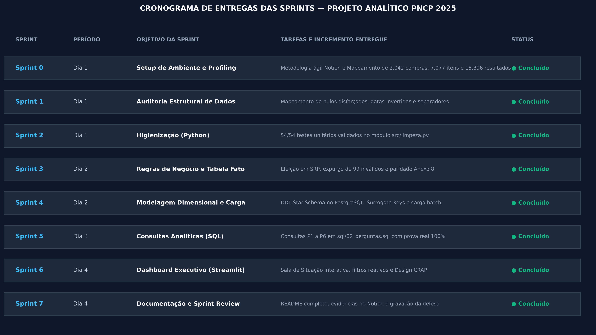

# 🏛️ Auditoria e Inteligência de Contratações Públicas Federais (PNCP 2025)


Esteira analítica ponta a ponta (*End-to-End*) desenvolvida para auditar compras e contratações públicas federais disponibilizadas pelo **Portal Nacional de Contratações Públicas (PNCP)** ao longo de todo o exercício de 2025.

O projeto resolve inconsistências estruturais e anomalias originadas em sistemas legados, aplica as regras contábeis e de controle externo da Controladoria Geral, estrutura os dados em modelagem dimensional *Star Schema* no PostgreSQL e disponibiliza uma Sala de Situação executiva interativa com foco em usabilidade, resiliência de ambiente, contraste e inteligência visual.

---

## 📅 Gestão Ágil e Planejamento em Sprints (Notion & Scrum/Kanban)

A governança do projeto foi conduzida por meio de uma abordagem híbrida **Scrum/Kanban** no **Notion**, estruturada em 8 ciclos de entrega (*Sprints 0 a 7*). Cada Sprint representou uma entrega de valor (*Release*) com escopo delimitado, amparada por uma rigorosa **Definition of Done (DoD)** e limitação de trabalho em progresso (**WIP = 1**), garantindo foco, rastreabilidade técnica e sincronização contínua com os commits do Git.



### Detalhamento dos Ciclos de Entrega

* **Sprint 0: Setup de Ambiente e Profiling dos Dados (Semana 1)**
  * **Objetivo:** Estabelecer o repositório Git, o isolamento do ambiente virtual (`.venv`) e mapear as estruturas brutas (`compras.csv`, `itens.csv`, `resultados.csv`).
  * **Tarefas Entregues:** Configuração de convenção de commits imperativos; profiling volumétrico inicial da base bruta; diagnóstico de encoding e tipos de dados primitivos.
  * **Definition of Done (DoD):** Mapeamento volumétrico consolidado (2.042 contratações, 7.077 itens e 15.896 resultados) e ambiente de desenvolvimento isolado e versionado.

* **Sprint 1: Auditoria Estrutural de Inconsistências (Semana 2)**
  * **Objetivo:** Auditar falhas de integridade sem alterar a base bruta, catalogando armadilhas sintáticas para subsidiar a camada de limpeza.
  * **Tarefas Entregues:** Diagnóstico de perda de zeros à esquerda em CNPJ/CPF; identificação de nulos mascarados; levantamento de separadores numéricos mistos; mapeamento de inversões cronológicas de homologação.
  * **Definition of Done (DoD):** Catálogo formal de anomalias registrado no repositório com quantificação dos registros afetados por cada regra.

* **Sprint 2: Higienização Atômica de Dados em Python (Semana 3)**
  * **Objetivo:** Desenvolver funções puras e modulares de sanitização no módulo `src/limpeza.py`.
  * **Tarefas Entregues:** Regex de identificadores com preenchimento de zeros (`.zfill`); algoritmo de normalização para separadores decimais e remoção de caracteres monetários; padronização de encodings (UTF-8) e conversão de strings "zumbis" para `None`.
  * **Definition of Done (DoD):** 54 de 54 testes unitários automatizados aprovados via execução do autoteste (`python -m src.limpeza`).

* **Sprint 3: Regras de Negócio e Montagem da Fato (Semana 4)**
  * **Objetivo:** Executar o motor contábil da Controladoria em `src/montar_tabelas.py`, gerando os conjuntos processados em `data/processed/`.
  * **Tarefas Entregues:** Grão atômico por item contratado com fornecedor vencedor; descarte prévio de cancelados em SRP; eleição por classificação e desempate por sequencial; descarte de 852 itens sem resultado; expurgo estrito de 99 itens impossíveis; cálculo de comparabilidade e classificação de perfil por regex com boundary (`\bobra\b`).
  * **Definition of Done (DoD):** Conformidade matemática absoluta com a Prova Real do Anexo 8 (6.126 linhas na Fato e R$ 8.044.498.805,74 homologados).

* **Sprint 4: Modelagem Dimensional e Carga PostgreSQL (Semana 5)**
  * **Objetivo:** Estruturar o banco relacional Star Schema e automatizar a ingestão em lote.
  * **Tarefas Entregues:** DDL `sql/01_criar_banco.sql` com 1 Fato e 4 Dimensões; chaves substitutas inteiras (`sk_*`) e chaves naturais `UNIQUE`; constraints `CHECK` como 2ª barreira de defesa; script `src/carregar.py` implementando ingestão em lote via `execute_values`.
  * **Definition of Done (DoD):** Banco recriado e carregado automaticamente, zero chaves estrangeiras órfãs e validação de integridade referencial ativa.

* **Sprint 5: Consultas Analíticas da Controladoria em SQL (Semana 6)**
  * **Objetivo:** Formular as queries estratégicas das 6 perguntas de negócio no arquivo `sql/02_perguntas.sql`.
  * **Tarefas Entregues:** Consultas P1 a P6 auditadas; cálculo de deságio ponderado (`SOMA / SOMA`) sobre a base comparável; agregações com `HAVING` por nome padronizado de órgão; subconsultas para concentração orçamentária do Top 10 fornecedores.
  * **Definition of Done (DoD):** Todas as 6 consultas executadas no PostgreSQL retornando métricas idênticas à Prova Real.

* **Sprint 6: Dashboard Analítico Executivo (Semana 7)**
  * **Objetivo:** Projetar e construir a aplicação executiva web interativa em Streamlit e Plotly.
  * **Tarefas Entregues:** Sala de Situação consolidada (Home) e 6 painéis temáticos; menu lateral retrátil; filtro dinâmico reativo por Perfil de Gasto recalculando métricas e conclusões; Design Tokens de cores unificados; compatibilidade nativa de contraste para Dark e Light Mode; eliminação de avisos de depreciação de tela (`width='stretch'`).
  * **Definition of Done (DoD):** Interface executiva funcional conectada ao PostgreSQL via `psycopg2`, sem truncamento de rótulos e com paridade de dados completa.

* **Sprint 7: Documentação, Reprodutibilidade e Vídeo (Semana 8)**
  * **Objetivo:** Consolidar a documentação no `README.md`, arte gráfica do cronograma e gravação da defesa técnica executiva.
  * **Tarefas Entregues:** Geração do cronograma visual `docs/img/sprints.png` sem colisões e com períodos; implementação de redundância de alta disponibilidade (Fallback automático PostgreSQL $\rightarrow$ CSVs processados); sincronização do quadro Kanban no Notion; gravação e publicação da Sprint Review em vídeo.
  * **Definition of Done (DoD):** Repositório público no GitHub com histórico de commits estruturado e link público de vídeo anexado.

---

## 🏗️ Arquitetura da Esteira e Engenharia de Dados

A esteira adota uma arquitetura modular em três camadas desacopladas com barreira dupla de integridade e mecanismo de alta disponibilidade:

```text
[Dados Brutos: data/raw/]
   ├── compras.csv (2.042 contratações)
   ├── itens.csv (7.077 itens licitados)
   └── resultados.csv (15.896 propostas classificadas)
             │
             ▼ (Camada 1: Higienização Atômica - src/limpeza.py)
   [Regex de Identificadores, Separadores Decimais e Eliminação de Nulos Ocultos]
             │
             ▼ (Camada 2: Regras Contábeis da Controladoria - src/montar_tabelas.py)
   [Eleição SRP, Filtro de Descarte, Expurgo de Inválidos, Comparabilidade e Perfil]
             │
             ▼ (Armazenamento Transitório: data/processed/)
   [CSVs higienizados da Fato e das 4 Dimensões]
             │
             ▼ (Camada 3: Ingestão Relacional Batch - src/carregar.py)
   [PostgreSQL 16: Star Schema com Chaves Substitutas e Constraints CHECK]
             │
             ├───────────────────────────────────────────┐
             ▼                                           ▼
[Consultas SQL Analíticas]                    [Dashboard Executivo Web]
  (sql/02_perguntas.sql)                        (powerbi/app.py - Streamlit)
                                                         │
                                             ┌───────────┴───────────┐
                                             ▼                       ▼
                                      [PostgreSQL 16]     [Fallback: CSVs]
                                      (Fonte Primária)    (Alta Disponibilidade)
```

### Decisão de Arquitetura: Camada Visual em Ambiente Unix Nativo & Alta Disponibilidade
O projeto foi desenvolvido sob ambiente nativo **Linux Zorin OS 18**. Para contornar limitações e instabilidades de renderização de emuladores (como Wine/WebView2 para Power BI Desktop) e priorizar padrões corporativos de nuvem e servidores Unix, a camada visual foi implementada como uma aplicação web corporativa em **Streamlit + Plotly**.

O painel foi equipado com uma rotina de **Fallback Híbrido Automático**:
1. **Origem Primária (PostgreSQL):** Consulta diretamente a camada relacional via pool de conexões `SQLAlchemy/psycopg2`.
2. **Origem de Contingência (CSVs Processados):** Se o serviço local do PostgreSQL não estiver ativo no momento da avaliação, a aplicação redireciona a carga automaticamente para os dados estruturados em `data/processed/`, exibindo o status de contingência no menu lateral sem interromper a execução nem quebrar a interatividade dos filtros e gráficos.

---

## 🗄️ Modelagem Dimensional (Star Schema)

A camada relacional foi modelada segundo a metodologia de Ralph Kimball, composta por 1 Tabela Fato numérica e 4 Tabelas Dimensão de contexto, relacionadas por Chaves Substitutas (*Surrogate Keys*) inteiras (`sk_*`).

```text
       ┌─────────────────┐               ┌──────────────────┐
       │   dim_orgao     │               │  dim_fornecedor  │
       ├─────────────────┤               ├──────────────────┤
       │ PK  sk_orgao    │               │ PK sk_fornecedor │
       │     cnpj_orgao  │               │    ni_fornecedor │
       │     nome_orgao  │               │    nome_fornec.  │
       │     poder       │               │    tipo_pessoa   │
       └────────┬────────┘               └────────┬─────────┘
                │ 1                               │ 1
                │                                 │
                │         ┌──────────────────────┐│
                └────────>│ fato_item_contratado │<┘
                          ├──────────────────────┤
                          │ PK  sk_fato          │
                          │ FK  sk_orgao         │
                          │ FK  sk_fornecedor    │
                          │ FK  sk_modalidade    │
                          │ FK  sk_localidade    │
                          │     data_publicacao  │
                          │     data_homologacao │
                          │     descricao_item   │
                          │     perfil_gasto     │
                          │     quantidade       │
                          │     vl_total_estimado│
                          │     vl_total_homolog.│
                          │     comparavel       │
                          │     economia_valor   │
                          │     dias_ciclo       │
                          └──────────┬───────────┘
                                     │
                ┌────────────────────┴──────────────────┐
                │ N                                     │ N
       ┌────────┴────────┐                     ┌────────┴─────────┐
       │ dim_modalidade  │                     │  dim_localidade  │
       ├─────────────────┤                     ├──────────────────┤
       │ PK sk_modalidade│                     │ PK sk_localidade │
       │    modalidade_id│                     │    uf_sigla      │
       │    nome_modalid.│                     │    uf_nome       │
       │                 │                     │    regiao        │
       └─────────────────┘                     └──────────────────┘
```

* **Chaves e Unicidade:** Cada dimensão preserva sua chave natural de origem (`cnpj_orgao`, `ni_fornecedor`, `modalidade_id`, `uf_sigla`) protegida por restrição `UNIQUE`.
* **Segunda Barreira de Defesa:** A tabela Fato implementa constraints `CHECK` que barram quantidades $\le 0$ e valores monetários negativos, garantindo tipos estritos `DECIMAL(18,2)` e `DECIMAL(18,4)`.

---

## 🧹 Dicionário de Anomalias e Higienização Aplicada

| Desafio | Causa Raiz Identificada | Regra e Tratamento Implementado |
| :--- | :--- | :--- |
| **Identificadores (CNPJ/CPF)** | Perda de zeros à esquerda por conversão numérica em planilhas e máscaras inconsistentes. | Extração de dígitos via regex; preenchimento sistemático com `.zfill(14)` para PJ e `.zfill(11)` para PF. |
| **Separadores Numéricos** | Inversão de pontuação (`0,754` e `746.815`), símbolos monetários (`R$`) e espaços invisíveis. | Regra estrita: separador isolado é decimal; separadores repetidos são milhares; conversão direta para float nativo. |
| **Campos Zumbis** | Valores nulos mascarados como texto: `"N/A"`, `"NULL"`, `"-"`, `"0"`, `"SEM INFORMAÇÃO"`. | Conversão para nulo nativo (`None` / `NULL`). O caractere `"0"` só é tratado como nulo em campos textuais. |
| **Cronologia Temporal** | Homologações registradas em datas anteriores à publicação do edital. | Anulação do campo `data_homologacao` e definição de `dias_ciclo = NULL` (Regra 7), mantendo o item na Fato sem distorcer o ciclo médio. |
| **Eleição Vencedor SRP** | Múltiplos fornecedores classificados por item em Sistema de Registro de Preços. | Descarte prévio de registros cancelados (`data_cancelamento`) e eleição do menor `ordem_classificacao_srp` (desempate por menor `sequencial`). |
| **Expurgo de Inválidos** | Itens com quantidades $\le 0$, valores $\le 0$, sigilosos ou com distorções $> 1000\times$. | Expurgo estrito de 99 itens impossíveis da tabela fato (Regra 4). |
| **Perfil do Gasto** | Necessidade de segregação contábil entre Bens, Serviços e Obras/Engenharia. | Classificação por regex com boundary (`\bobra\b`, `\bconstrução\b`, `\breforma\b`, `\bengenharia\b`) no objeto e descrição. |

---

## 🎯 Prova Real e Resultados Auditados (Conferência com Anexo 8)

| Indicador Analítico | Valor Esperado (Anexo 8) | Valor Obtido no Pipeline | Conformidade |
| :--- | :---: | :---: | :---: |
| **Linhas da Fato** | 6.126 | 6.126 | ✅ 100% OK |
| **Itens Rejeitados (Inválidos)** | 99 | 99 | ✅ 100% OK |
| **Itens Descartados sem Resultado** | 852 | 852 | ✅ 100% OK |
| **Volume Total Homologado** | R$ 8.044.498.805,74 | R$ 8.044.498.805,74 | ✅ 100% OK |
| **Itens na Base Comparável** | 5.457 | 5.457 | ✅ 100% OK |
| **Economia Nominal** | R$ 992.861.686,95 | R$ 992.861.686,95 | ✅ 100% OK |
| **Taxa de Economia / Deságio** | 14,46% | 14,46% | ✅ 100% OK |
| **Ciclo Médio de Compras** | 48,1 dias | 48,1 dias | ✅ 100% OK |
| **Ciclo Máximo** | 611 dias | 611 dias | ✅ 100% OK |
| **Itens sem Ciclo (Invertidos/Nulos)** | 230 | 230 | ✅ 100% OK |
| **Perfil: Obras e Engenharia** | 60,8% (967 itens) | 60,8% (967 itens) | ✅ 100% OK |
| **Perfil: Serviços** | 36,6% (1.849 itens) | 36,6% (1.849 itens) | ✅ 100% OK |
| **Perfil: Bens** | 2,6% (3.310 itens) | 2,6% (3.310 itens) | ✅ 100% OK |

---

## 📊 Síntese Analítica das 6 Perguntas da Controladoria

1. **Economia Global do Poder Público:** O governo federal economizou nominalmente **R$ 992,86 milhões**, representando um deságio médio de **14,46%** sobre a base comparável (**89,08%** dos itens auditados).
2. **Concentração e Risco de Fornecedores:** Risco de dependência acentuado: apenas 10 grupos econômicos detêm **41,43%** do orçamento homologado total (**R$ 3,33 bilhões**).
3. **Eficácia por Modalidade:** A Concorrência Eletrônica absorve o maior montante financeiro (**58,43%** do volume), enquanto o Pregão Eletrônico desponta com o maior deságio competitivo (**24,02%** de economia média). O Credenciamento opera com deságio nulo (teto fixo).
4. **Tempo do Ciclo de Compras:** O ciclo médio federal é de **48,1 dias** (máximo de 611 dias). Universidades federais e conselhos de fiscalização profissional lideram a lentidão, superando 200 dias de tramitação interna. 230 certames registraram datas anômalas/invertidas.
5. **Distribuição Regional:** A região Centro-Oeste centraliza o maior volume financeiro (**R$ 3,56 bilhões** / 38,98% no DF), mas a Região Norte alcançou o melhor índice de deságio (**21,43%** de desconto).
6. **Perfil dos Gastos:** Obras e Engenharia concentram a maior parte dos recursos (**60,8%** do valor; ticket médio de R$ 5,06 milhões), ao passo que Bens lideram em volume operacional de itens contratados (**54%** das linhas da Fato).

---

## 🚀 Guia de Reprodutibilidade (Passo a Passo)

### 1. Clonar o Repositório e Configurar o Ambiente Virtual
```bash
git clone [https://github.com/LFelipeMartins-stack/projeto-avaliativo-modulo-2.git](https://github.com/LFelipeMartins-stack/projeto-avaliativo-modulo-2.git)
cd "projeto-avaliativo-modulo-2"

# Criar e ativar o ambiente virtual no Linux
python3 -m venv .venv
source .venv/bin/activate

# Instalar todas as dependências do ecossistema
pip install -r requirements.txt
```

### 2. Configurar Credenciais do Banco (Opcional caso use Fallback)
Crie o arquivo `.env` a partir do modelo e configure suas credenciais locais do PostgreSQL:
```bash
cp .env.example .env
nano .env
```

### 3. Execução da Esteira Completa (ETL e Ingestão)
```bash
# 1. Executa autoteste de higienização atômica (54/54 testes unitários)
python -m src.limpeza

# 2. Aplica regras contábeis, filtros e gera base processada
python -m src.montar_tabelas

# 3. Recria o banco de dados, cria DDL Star Schema e faz ingestão batch
python -m src.carregar
```

### 4. Inicialização da Sala de Situação Executiva
```bash
python -m streamlit run powerbi/app.py
```
Acesse a aplicação no navegador em: `http://localhost:8501`

*(Nota: Caso o PostgreSQL não esteja rodando localmente, o dashboard inicializará automaticamente consumindo os arquivos higienizados em `data/processed/`, com telemetria indicada no menu lateral).*

---

## 📹 Apresentação Técnica e Defesa do Projeto (Sprint Review)

* **Link da Apresentação (Google Drive com Acesso Público):** [INSERIR_LINK_AQUI]

### Propostas de Evolução Futura
1. **Orquestração Automatizada com Apache Airflow:** Construção de DAGs para ingestão diária e incremental conectada à API oficial do PNCP, com alertas de monitoramento via webhook.
2. **Conteinerização com Docker Compose:** Empacotamento de toda a infraestrutura (PostgreSQL 16 + Dashboard Streamlit + Carga) em containers padronizados para implantação multi-cloud.
3. **Detecção de Anomalias com Machine Learning:** Implementação de modelos estatísticos e Isolation Forests para detecção preditiva de itens com indício de conluio ou sobrepreço extremo antes da fase de homologação.